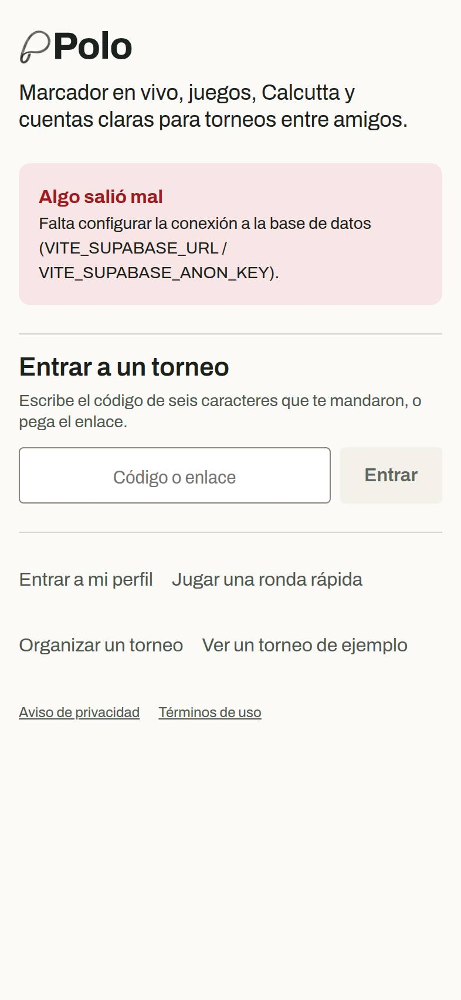
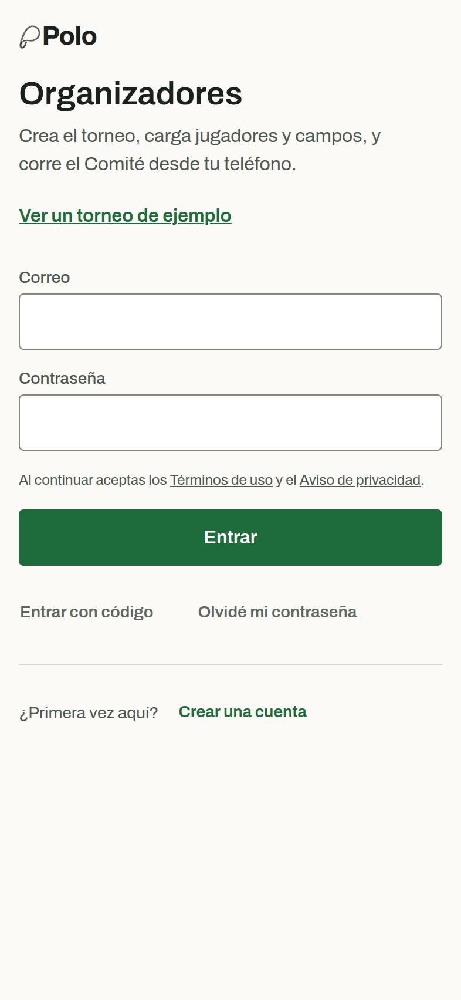
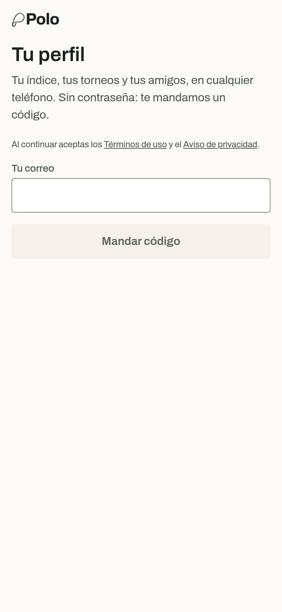

# Una puerta y una casa para las cuentas

Propuesta del 2026-10-16 para STRAT-06 y STRAT-07 (revisión del 2026-09-30). **Diego decide** (docs/handoff.md, punto 15). Nada de lo que cambia las puertas o las casas está hecho; solo un cambio de orden en Mi Polo, que se explica al final y se deshace en un commit.

## Lo que hay hoy

Una cuenta de Polo es una sola cosa (un correo en Supabase Auth), pero tiene dos puertas y dos casas.

### Dos puertas

| | `/organizer/login` («Organizadores») | `/entrar` («Tu perfil») |
|---|---|---|
| Cómo se entra | Correo y contraseña. «Entrar con código» como opción callada, «Olvidé mi contraseña», «Crear una cuenta» con contraseña de 8 o más | Correo y un código de 6 dígitos. Google (salvo en la app de iPhone, donde la vuelta de Google cae en Safari) |
| Qué hace con el teléfono | Si el teléfono entró con PIN, avisa que está entrando como jugador | Convierte el teléfono anónimo en la cuenta, en el mismo lugar: su PIN y lo que tenga sin mandar siguen valiendo |
| A dónde lleva | Siempre a `/organizer` (Mis torneos) | A `next` si lo trae, si no a `/` (Mi Polo) |
| Quién la abre | Inicio › «Organizar un torneo»; el asistente y Mis torneos sin sesión; el RUNBOOK (el Comité) | Inicio › «Entrar a mi perfil» y «Jugar una ronda rápida»; Más › «Guarda tu perfil»; «Guarda tus rondas» (STRAT-08) |

  

*Capturas de la build de fixtures (`npm run build:fixtures`), a 393 px, 2026-10-16. Esa build no tiene base de datos: el aviso rojo de Inicio no sale en producción.*

### Dos casas

- **Mi Polo** (`/` con cuenta, `src/screens/profile/MiPolo.tsx`): el saludo y el perfil, «¿Eres tú?», tus torneos por estado (en juego, próximos, jugados: los que juegas y los que organizas, marcados «Comité»), crews, lo de tus amigos, el código para entrar y, abajo, «Mis torneos como organizador».
- **Mis torneos** (`/organizer`, `src/screens/organizer/MyTournamentsScreen.tsx`): los torneos que organizas por estado, con «Nuevo torneo», el código, el enlace, «Duplicar» y la entrada al Comité.

Mi Polo no tiene captura: necesita una cuenta y ningún fixture la arma. Su orden, de arriba abajo, hoy: barra (avisos, amigos, ajustes) · «Hola, …» · **Organizar un torneo** y **Ronda rápida** (desde este cambio) · «¿Eres tú?» · En juego · Próximos · Crews · Lo de tus amigos · Jugados · Entrar a un torneo · «Mis torneos como organizador».

### Lo que se rompe

1. Quien creó su cuenta con Google en `/entrar` y luego toca «Organizar un torneo» sin sesión llega a una pantalla de contraseña sin Google. No tiene contraseña. El camino es «Entrar con código», el botón más callado.
2. Quien organiza tiene dos listas de los mismos torneos, con acciones distintas en cada una («Duplicar» solo en Mis torneos).
3. El asistente sin sesión manda a `/organizer/login`, que al terminar lleva a Mis torneos, no de vuelta al asistente: la misma pérdida de intención que UX-25 arregló para Ronda rápida.
4. Las preguntas de soporte («¿dónde está mi torneo?», «¿cuál es mi contraseña?») crecen con cada organizador nuevo, y la apuesta 2 de la estrategia son cinco organizadores que no son Diego.

## Las opciones

### A. Una puerta y una casa (lo que recomiendo)

- `/entrar` es la única puerta: código primero, Google, y «Entrar con contraseña» para las cuentas que ya tienen una (la de Diego y la de las capturas). La intención (`?para=organizar`) cambia solo el título y la frase de arriba. `/organizer/login` redirige ahí con la misma intención y su `next`.
- Mi Polo es la única casa. Su primera sección es **Tus eventos**, con un solo botón primario, **Organizar**, que pregunta «¿Un torneo o una ronda?». Las acciones de Mis torneos (Comité, código, enlace, Duplicar) pasan a cada renglón que organizas. `/organizer` queda como alias de esa sección, para no romper enlaces viejos.
- El perfil y el índice quedan como lo segundo, no lo primero.
- **Costo:** 2 a 3 días de trabajo, gratis. Pruebas: cada puerta (Inicio, Más, el asistente, Mis torneos, Entrar del torneo) termina en la misma pantalla y en la misma casa; `e2e/profile.mjs` con correo real; el RUNBOOK dice «entra en /entrar». Riesgo: el Comité del viaje ya entra por `/organizer/login`; con la redirección, su enlace sigue funcionando.
- **Cuándo:** antes del primer ensayo (13 y 14 de febrero), para que los 12 teléfonos la prueben.

### B. Una puerta, dos casas

- Lo mismo de la puerta de A, pero Mis torneos se queda como la casa de quien entra a organizar, y Mi Polo como la de todos los demás.
- **Costo:** 1 día. Arregla 1 y 3; deja 2 y 4 a medias.

### C. Dejarlo y parchar

- Google también en `/organizer/login`, y que vuelva al asistente si de ahí vino.
- **Costo:** medio día. Arregla 1 y 3. Quedan dos maneras de entrar escritas dos veces (dos pantallas, dos juegos de pruebas) y dos listas.

## Recomendación

**A**, antes del primer ensayo. La estrategia dice que el producto es organizar el torneo del grupo y que la cuenta es de quien organiza; dos puertas y dos casas para una sola cuenta es lo contrario. Medir después (STRAT-02, ya en Salud): cuántos organizadores llegan de la puerta a «Torneo creado», y cuántos torneos contra rondas rápidas se crean, antes de darle más peso a cualquiera de los dos.

## Lo que sí cambié hoy (y cómo deshacerlo)

En Mi Polo, **«Organizar un torneo»** pasó de un botón fantasma pequeño hasta abajo a ser el primer botón, de ancho completo, con su línea («Un viaje o el torneo del grupo: juegos, Calcutta y las cuentas al peso»). **«Ronda rápida»** sigue con su botón de ancho completo y su línea, justo abajo, como secundario. El botón fantasma de abajo se quitó (era el mismo destino). Nada más cambió: ni las puertas, ni a dónde lleva cada una, ni Mis torneos.

Si prefieres el orden de antes, es revertir el bloque `cta` de `MiPolo.tsx` (un commit; la prueba es «Mi Polo’s first actions (STRAT-07)» en `src/screens/HomeScreen.account.test.tsx`).
